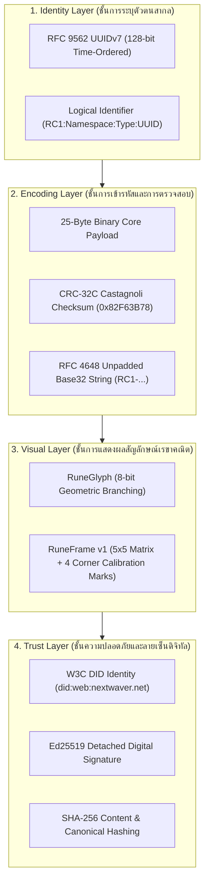
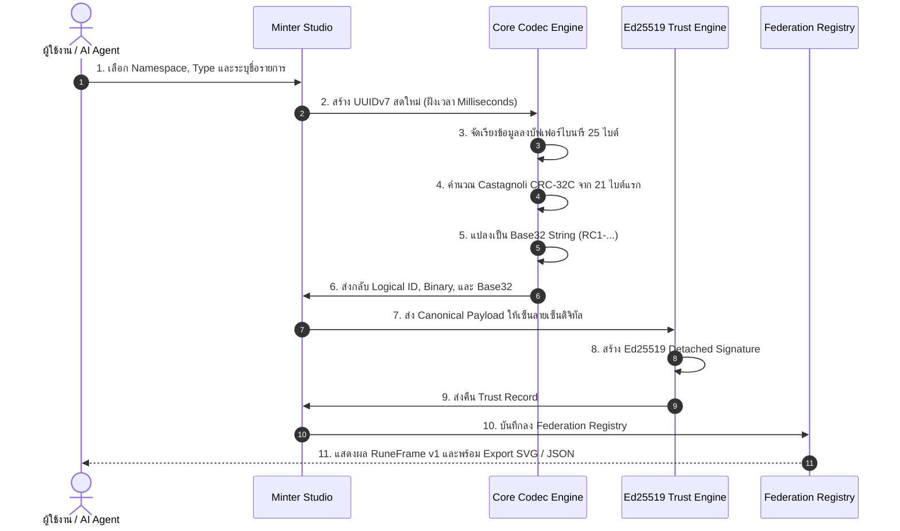
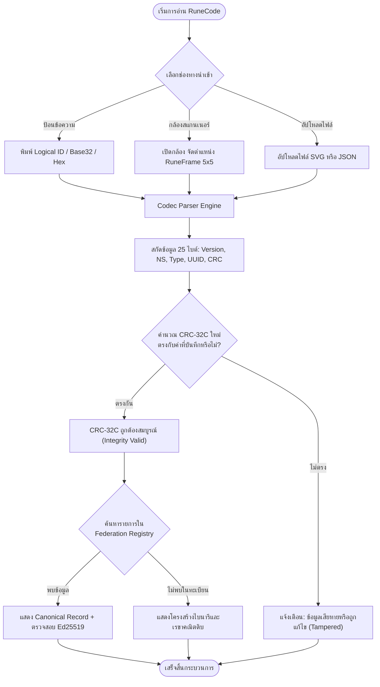
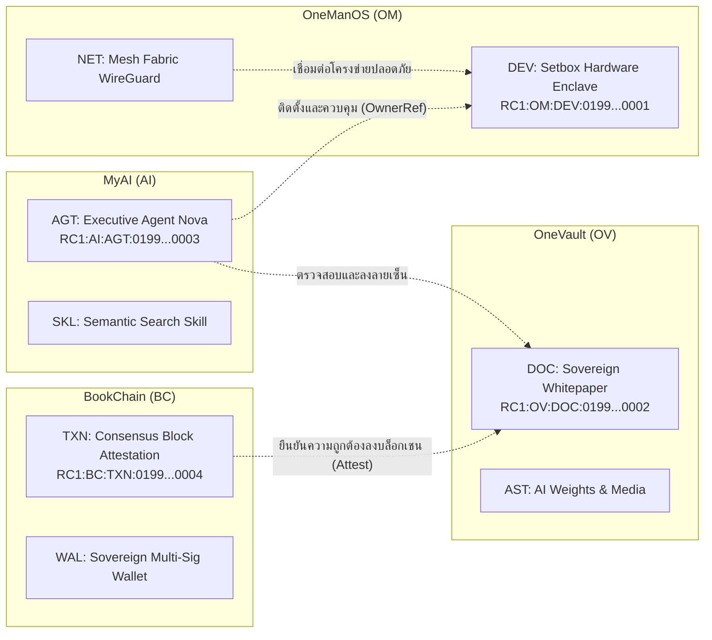

# RuneCode v1.0 — คู่มือการใช้งานระบบ สถาปัตยกรรม และคำอธิบายเชิงลึก
**The Official Beginner's Guide & System Reference for RuneCode v1.0**  
*สำหรับ OneManOS · OneVault · MyAI · BookChain (Nextwaver Ecosystem)*

---

## 1. บทนำ: ทำความรู้จัก RuneCode สำหรับผู้เริ่มต้น (Introduction)

ยินดีต้อนรับสู่ **RuneCode v1.0 Studio**! หากคุณเป็นผู้เริ่มต้นและยังไม่เคยรู้จัก RuneCode มาก่อน ส่วนนี้จะอธิบายแนวคิดทั้งหมดด้วยภาษาง่ายๆ พร้อมตัวอย่างที่เห็นภาพชัดเจน

### 1.1 RuneCode คืออะไร?
ลองจินตนาการถึง **QR Code** หรือ **Barcode** ที่เราสแกนกันในชีวิตประจำวัน:
- QR Code ถูกสร้างขึ้นเพื่อให้คอมพิวเตอร์และกล้องอ่านอย่างเดียว มนุษย์ไม่สามารถมองด้วยตาเปล่าแล้วรู้ได้เลยว่าเป็นรหัสของอะไร
- Barcode แบบเดิมไม่สามารถบรรจุข้อมูลตัวตน (Identity), ประเภทของอุปกรณ์, การตรวจสอบความถูกต้อง (Integrity), และลายเซ็นดิจิทัล (Digital Signature) ได้พร้อมกัน

**RuneCode** คือ **Universal Visual Identifier (รหัสภาพสากล)** ที่ออกแบบมาเพื่อแก้ปัญหานี้ โดยนำแนวคิดการประกอบเส้นเรขาคณิตจาก **Trunic** (ภาษารูนที่สร้างจากเส้นกิ่งก้านรอบแกนกลาง) มารวมเข้ากับ **คณิตศาสตร์คอมพิวเตอร์ 8 บิต**

ผลลัพธ์คือ:
1. **มนุษย์มองออก**: รูปร่างของรูนบอกเอกลักษณ์ได้ทันที และเมื่อคุ้นเคยจะสามารถอ่านค่าบิตและประเภทของระบบได้ด้วยตาเปล่า
2. **คอมพิวเตอร์ถอดรหัสได้ 100%**: ทุกเส้นบนตัวรูนตรงกับค่าบิต `0` หรือ `1` ในข้อมูลไบนารีแท้
3. **ตรวจสอบความปลอดภัยได้**: มีระบบเช็กซัม **CRC-32C** ป้องกันข้อมูลเสียหาย และมีลายเซ็นดิจิทัล **Ed25519** ป้องกันการปลอมแปลง

---

## 2. อภิธานศัพท์และคำศัพท์ทางเทคนิค (Glossary of Technical Terms)

เพื่อให้เข้าใจระบบได้รวดเร็ว ตารางนี้รวบรวมคำศัพท์สำคัญที่พบบ่อยในระบบ RuneCode:

| คำศัพท์ (Term) | ความหมายและบทบาทในระบบ |
| :--- | :--- |
| **RuneGlyph** | สัญลักษณ์รูนเรขาคณิต 1 ตัว ซึ่งแทนค่าข้อมูลขนาด **1 ไบต์ (8 บิต)** พอดี โดยมีเส้นแกนกลางเป็นแกนอ้างอิง และมีเส้นกิ่งก้าน 8 เส้นรอบแกน |
| **RuneFrame** | เมทริกซ์สี่เหลี่ยมจัตุรัสขนาด **5×5 ช่อง (รวม 25 ไบต์)** ล้อมรอบด้วยกรอบจัดตำแหน่ง 4 มุม และรอยบากบอกทิศทาง ใช้สำหรับการสแกนด้วยกล้องหรือพิมพ์บนอุปกรณ์ |
| **Namespace (เนมสเปซ)** | หมวดหมู่หลักของระบบนิเวศ (2 ตัวอักษร): `OM` (OneManOS), `OV` (OneVault), `AI` (MyAI), `BC` (BookChain) |
| **Resource Type** | ประเภทเฉพาะของทรัพยากรภายในเนมสเปซนั้นๆ (3 ตัวอักษร) เช่น `DEV` (อุปกรณ์), `DOC` (เอกสาร), `AGT` (เอเจนต์ AI), `TXN` (บล็อกธุรกรรม) |
| **UUIDv7 (RFC 9562)** | รหัสสุ่มสากลขนาด 128 บิตที่ไม่ซ้ำกัน โดย 48 บิตแรกถูกฝังด้วยเวลา (Timestamp) ทำให้สามารถเรียงลำดับเอกสารหรืออุปกรณ์ตามเวลาที่ถูกสร้างขึ้นได้อัตโนมัติ |
| **Logical Identifier** | รูปแบบข้อความของรหัสที่มนุษย์อ่านได้ เช่น `RC1:OM:DEV:0199a5b2-7c80-7000-8000-000000000001` |
| **Binary Payload (25 Bytes)** | ข้อมูลไบนารีระดับล่างขนาด 25 ไบต์ ประกอบด้วย Version (1B) + Namespace (1B) + Type (1B) + UUIDv7 (16B) + Flags (2B) + CRC-32C (4B) |
| **CRC-32C (Castagnoli)** | อัลกอริทึมตรวจสอบความถูกต้องของข้อมูล ใช้โพลีโนเมียล `0x82F63B78` เพื่อตรวจจับข้อผิดพลาดหรือการเปลี่ยนแปลงของข้อมูลแม้เพียง 1 บิต |
| **Base32 (RFC 4648)** | การแปลงข้อมูลไบนารี 25 ไบต์เป็นตัวอักษรภาษาอังกฤษและตัวเลข 40 ตัวอักษร (เช่น `RC1-AEARKY...`) โดยไม่มีเครื่องหมาย `=` เหมาะกับการพิมพ์และส่งต่อ |
| **Ed25519 Signature** | ลายเซ็นดิจิทัลเข้ารหัสความเร็วสูงระดับสากล ใช้กุญแจสาธารณะ (Public Key) และกุญแจส่วนตัว (Private Key) เพื่อรับรองว่าผู้ใดเป็นผู้ออกรหัสนี้อย่างแท้จริง |
| **W3C DID (`did:web`)** | Decentralized Identifier ตัวระบุตัวตนแบบกระจายศูนย์ เช่น `did:web:nextwaver.net` ซึ่งชี้ไปยังองค์กรผู้ออกใบรับรองโดยไม่ต้องผ่านเซิร์ฟเวอร์รวมศูนย์ |
| **Canonical Record** | โครงสร้างข้อมูล JSON มาตรฐานที่จัดระเบียบตามข้อกำหนด โดยแยก Identity, Metadata และ Trust ออกจากกันอย่างเคร่งครัด |
| **MCP (Model Context Protocol)** | โปรโตคอลมาตรฐานที่เปิดทางให้ AI Agents (เช่น Claude, Gemini) เรียกใช้งานเครื่องมือสร้างและอ่าน RuneCode ได้โดยตรง |

---

## 3. แผนภาพแสดงกระบวนการทำงานของระบบ (System Workflows & Diagrams in Mermaid)

### 3.1 แผนภาพสถาปัตยกรรม 4 ชั้น (4-Layer System Architecture)



---

### 3.2 แผนภาพวงจรชีวิตการออกรหัส (Minting & Verification Lifecycle Flow)



---

### 3.3 แผนภาพกระบวนการถอดรหัสและการสแกน (Scanner & Verification Flow)



---

### 3.4 แผนภาพการเชื่อมโยงข้าม 4 ระบบนิเวศ (Cross-Ecosystem Federation Links)



---

## 4. โครงสร้างเรขาคณิต 8 บิตของ RuneGlyph (Trunic Geometry Deep-Dive)

สัญลักษณ์ RuneGlyph ทุกตัวถูกสร้างขึ้นบนกรอบเวกเตอร์พิกัด `100 × 140`:
- **เส้นแกนกลาง (Reference Stem)**: ลากจากพิกัด `(50, 16)` ลงมาถึง `(50, 124)` มีสีจาง เป็นเพียงเส้นอ้างอิงตำแหน่ง (0 Data Entropy)
- **เส้นข้อมูล 8 บิต (Data Bits 0–7)**:

```
          [Bit 2: บนขวา]  (82, 22)
(18, 22)  [Bit 0: บนซ้าย]    \     /
    \        /                 \   /
     \      /                   \ /
   (50, 46) ────────┬────────── (50, 46)
   [Bit 1: ปีกซ้ายบน] │           [Bit 3: ปีกขวาบน]
                    │
   [Bit 7: แถบเข็มขัดและเพชรแกนกลาง (50, 70)]
                    │
   (50, 94) ────────┴────────── (50, 94)
     /      \                   / \
    /        \                 /   \
(18, 118) [Bit 4: ล่างซ้าย]  (82, 118) [Bit 6: ล่างขวา]
   [Bit 5: ปีกซ้ายล่าง]
```

### การจับคู่บิต (Bit Mapping Table):
- **Bit 0 (0x01)**: Upper-Left Diagonal Arm (เส้นเฉียงบนซ้าย)
- **Bit 1 (0x02)**: Upper-Left Lateral Wing (ปีกแนวตั้งบนซ้าย)
- **Bit 2 (0x04)**: Upper-Right Diagonal Arm (เส้นเฉียงบนขวา)
- **Bit 3 (0x08)**: Upper-Right Lateral Wing (ปีกแนวตั้งบนขวา)
- **Bit 4 (0x10)**: Lower-Left Diagonal Leg (เส้นเฉียงล่างซ้าย)
- **Bit 5 (0x20)**: Lower-Left Lateral Wing (ปีกแนวตั้งล่างซ้าย)
- **Bit 6 (0x40)**: Lower-Right Diagonal Leg (เส้นเฉียงล่างขวา)
- **Bit 7 (0x80)**: Central Keystone & Belt (แถบเข็มขัดแนวนอนและเพชรแกนกลาง)

> **ตัวอย่างในข้อกำหนด**: สำหรับไบต์ค่า `0xA5` (เทียบเท่า `10100101` ในเลขฐานสอง) จะมีเฉพาะ Bit 0, Bit 2, Bit 5 และ Bit 7 เป็น `1` จึงวาดเฉพาะ 4 ตำแหน่งนั้นพอดี

---

## 5. คู่มือการใช้งานระบบทีละขั้นตอน (Step-by-Step User Manual)

### ขั้นตอนที่ 1: การออกรหัสใหม่ (Minter Studio)
1. เปิดแถบเมนู **Studio** ด้านบน
2. เลือก **Ecosystem Namespace** ที่ต้องการ:
   - `OM` สำหรับอุปกรณ์ฮาร์ดแวร์หรือกล่อง Setbox
   - `OV` สำหรับเอกสารหรือไฟล์ข้อมูล
   - `AI` สำหรับหุ่นยนต์หรือเอเจนต์ปัญญาประดิษฐ์
   - `BC` สำหรับธุรกรรมหรือสัญญาบล็อกเชน
3. เลือก **Resource Type** (เช่น `DEV`, `DOC`, `AGT`)
4. กดปุ่ม **"Generate Fresh"** เพื่อให้ระบบสุ่ม UUIDv7 ตามเวลาปัจจุบัน (หรือกรอก UUID ที่มีอยู่แล้ว)
5. กรอกรายละเอียด:
   - **Display Name**: ชื่อที่มนุษย์เข้าใจง่าย เช่น "Edge Gateway Lab-1"
   - **Tenant ID**: รหัสองค์กร เช่น "nextwaver"
   - **Owner Ref**: ใส่รหัส RuneCode ของอุปกรณ์หรือเจ้าของที่เกี่ยวข้อง (ถ้ามี)
   - **Content Hash**: หากเป็นเอกสาร สามารถพิมพ์หรือกดปุ่มเพื่อคำนวณค่าแฮช SHA-256
6. สังเกตพรีวิวทางด้านขวา: ระบบจะเรนเดอร์เมทริกซ์ **RuneFrame v1 ขนาด 5×5 ช่อง** และคำนวณค่า CRC-32C ให้แบบเรียลไทม์
7. กดปุ่ม **"Mint & Attest RuneCode v1.0"**: ระบบจะทำการเซ็นลายเซ็น Ed25519 และบันทึกลงทะเบียนกลางทันที

---

### ขั้นตอนที่ 2: การทดลองประกอบเส้นรูน (Glyph Lab)
1. เปิดแถบเมนู **Glyph Lab**
2. คลิกที่เส้นบนตัวรูนเวกเตอร์ขนาดใหญ่โดยตรง หรือคลิกสวิตช์เปิด/ปิด **Bit 0 ถึง Bit 7** ด้านล่าง
3. สังเกตการเปลี่ยนแปลงแบบทันที:
   - ค่า **Hexadecimal** (เช่น `0xA5`)
   - ค่า **Decimal** (เช่น `165 / 255`)
   - ค่า **Binary Bits** (เช่น `10100101`)
4. ทดลองเลือก Preset สำเร็จรูปทางขวา เช่น *0xA5 (Spec Example)* หรือ *0x01 (Version)*
5. ในช่อง **RuneGlyph Inscription Strip**: พิมพ์คำภาษาอังกฤษใดๆ (เช่น `NEXT`) ระบบจะถอดรหัส UTF-8 และวาดสร้อยอักษรรูนเรียงกันให้โดยอัตโนมัติ

---

### ขั้นตอนที่ 3: การสแกนและถอดรหัส (Scanner & Decoder)
1. เปิดแถบเมนู **Scanner**
2. เลือกว่าจะป้อนข้อมูลด้วยวิธีใด:
   - **Text & Identifier**: วางรหัส `RC1:...` หรือ `RC1-...` หรือเลขฐานสิบหก 25 ไบต์ แล้วกด Decode
   - **Camera Scanner**: กดเปิดกล้อง แล้วนำภาพ RuneFrame v1 เข้ามาในกรอบ Viewfinder
   - **Import File / SVG**: ลากไฟล์ภาพเวกเตอร์ SVG หรือ JSON เข้ามา
3. ระบบจะแสดงผลการตรวจสอบ:
   - แถบสีเขียวรับรองว่า **CRC-32C เช็กซัมถูกต้อง** ข้อมูลไม่สูญหาย
   - ตารางแยกรายละเอียดไบต์ทั้ง 25 ไบต์ (Version, Namespace, Type, UUID, Flags, Checksum)
   - หากรหัสนี้ตรงกับข้อมูลในทะเบียน ระบบจะดึงชื่อเจ้าของและสถานะลายเซ็นดิจิทัลมาแสดงทันที

---

### ขั้นตอนที่ 4: การสืบค้นทะเบียนกลาง (Federation Explorer)
1. เปิดแถบเมนู **Federation**
2. ใช้ตัวกรองเลือกดูเฉพาะระบบที่สนใจ (`OneManOS`, `OneVault`, `MyAI`, `BookChain`) หรือค้นหาด้วยชื่อ
3. **สลับมุมมอง Grid / Topology**: คลิกปุ่ม **"Topology"** เพื่อดูแผนผังความสัมพันธ์โครงข่าย (Network Mesh Map) แสดงโหนดของ 4 ระบบที่เชื่อมโยงกันแบบอินเทอร์แอคทีฟ
4. **ออกรหัสพร้อมกันเป็นชุด (Batch Pipeline)**: คลิกปุ่ม **"Batch Pipeline"** เพื่อสร้างและเซ็นลายเซ็น RuneCode ครั้งละ 5–20 รายการ พร้อมดาวน์โหลด Batch JSON
5. คลิกที่รายการใดๆ เพื่อเปิดหน้าต่าง **Canonical Record Inspection**:
   - ดูภาพ RuneFrame v1 ของรายการนั้น
   - ตรวจสอบสถานะการยืนยันลายเซ็นดิจิทัล Ed25519
   - คลิกปุ่ม **"Generate Physical Laser Stencil Plate"** เพื่อสร้างแบบป้ายโลหะแกะสลักเลเซอร์ สเกลจริง 1:1 มม. พร้อมรูเจาะสกรู 4 มุม
   - คลิกที่ลิงก์ **Owner Link** เพื่อเดินทางข้ามระบบ เช่น คลิกจาก AI Agent เพื่อดูฮาร์ดแวร์ Setbox ที่เป็นเจ้าของ
   - กดปุ่ม **Download JSON** หรือ **Download SVG** เพื่อนำไปใช้งานต่อ

---

### ขั้นตอนที่ 5: ตรวจสอบความปลอดภัยและกุญแจ (Trust & DID)
1. เปิดแถบเมนู **Trust & DID**
2. **Authority & Keyrings**:
   - ดูข้อมูลระบุตัวตนของผู้ออกใบรับรองหลัก (`did:web:nextwaver.net`) และกุญแจสาธารณะ Ed25519
   - กดปุ่ม **Generate New** ในส่วน Sub-Authority หากต้องการสร้างกุญแจคู่ใหม่สำหรับเครื่องลูกข่ายหรือเอเจนต์อิสระ
   - ในส่วน **Cryptographic Signature Verifier Testbed**: วาง JSON ใดๆ แล้วกดทดสอบ ระบบจะตรวจสอบคณิตศาสตร์ของลายเซ็นดิจิทัลให้ทันที
3. **Agent MCP Console**:
   - สลับแท็บไปยัง **"Agent MCP Console"** เพื่อทดสอบการเรียกใช้งานเครื่องมือ Model Context Protocol จำลองแบบ AI Agent (`runecode_resolve`, `runecode_mint`, `runecode_verify_signature`) พร้อมวัดความเร็ว Latency (ms) แบบเรียลไทม์

---

## 6. คำแนะนำสำหรับนักพัฒนา (Developer Integration Guide)

### 6.1 โครงสร้างไฟล์ในโครงการ (File Tree)
```
/
├── designspec.md                # ข้อกำหนดสถาปัตยกรรมทางวิศวกรรม
├── README.md                    # คู่มือฉบับสมบูรณ์ (ไฟล์นี้)
├── src/
│   ├── lib/runecode/
│   │   ├── types.ts             # ประกาศ Type และ Namespace Registry
│   │   ├── crc32c.ts            # อัลกอริทึม Castagnoli CRC-32C
│   │   ├── base32.ts            # RFC 4648 Base32 Codec
│   │   ├── uuidv7.ts            # RFC 9562 UUIDv7 Generator & Parser
│   │   ├── codec.ts             # ตัวแปลง 25-Byte Binary / Logical ID
│   │   ├── glyph.ts             # ฟังก์ชันเรขาคณิตเวกเตอร์ RuneGlyph 8 บิต
│   │   ├── crypto.ts            # การลงลายเซ็น Ed25519 และ SHA-256
│   │   └── sampleData.ts        # ข้อมูลตั้งต้นจำลองทั้ง 4 ระบบ
│   ├── components/
│   │   ├── Navbar.tsx           # แถบเมนูด้านบน (Top Bar 3 Zones)
│   │   ├── RuneGlyphView.tsx    # คอมโพเนนต์ SVG เรนเดอร์ 1 รูน (8 บิต)
│   │   ├── RuneFrameView.tsx    # คอมโพเนนต์เมทริกซ์ 5x5 RuneFrame v1
│   │   ├── StudioMinter.tsx     # หน้าจอ Mint และออกรหัส
│   │   ├── GlyphLab.tsx         # หน้าจอห้องทดลองเรขาคณิต
│   │   ├── ScannerDecoder.tsx   # หน้าจอถอดรหัสและกล้องสแกน
│   │   ├── FederationExplorer.tsx # หน้าจอทะเบียนกลางข้ามระบบ
│   │   ├── TrustAuthority.tsx   # หน้าจอกุญแจและลายเซ็นดิจิทัล
│   │   ├── HelpModal.tsx        # คู่มือการใช้งานอินเทอร์แอคทีฟในแอป
│   │   └── DevSpecsModal.tsx    # ข้อมูลจำเพาะทางเทคนิคและ MCP
│   ├── App.tsx                  # คอมโพเนนต์หลักของแอปพลิเคชัน
│   └── main.tsx                 # Entry Point ของ React
```

---

## 7. บทสรุปและการติดต่อสอบถาม (Summary)

RuneCode v1.0 ไม่ได้ถูกสร้างขึ้นมาเพื่อแทนที่ภาษาพูดหรือการเข้ารหัสลับ แต่เป็น **ภาษาสัญลักษณ์ดิจิทัลที่มีโครงสร้างทางคณิตศาสตร์** เพื่อสร้างตัวตนและสัญลักษณ์ที่ตรวจสอบย้อนกลับได้ ช่วยให้ทั้งมนุษย์และ AI ในระบบนิเวศ Nextwaver ทำงานประสานกันได้อย่างไร้รอยต่อ
