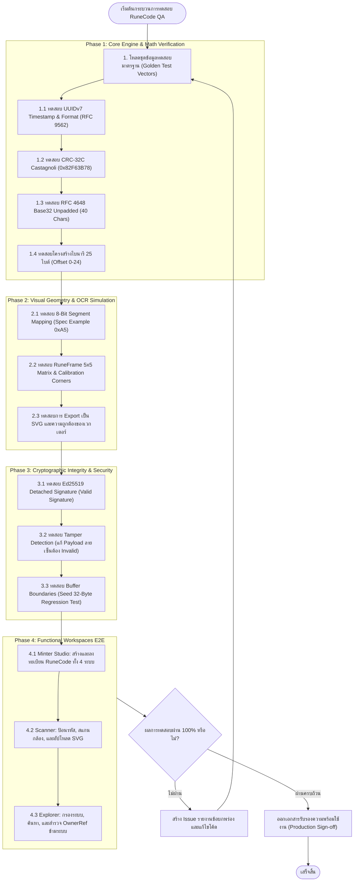

# RuneCode v1.0 — Test Specification & Quality Assurance Blueprint
**เอกสารข้อกำหนดการทดสอบระบบ แผนการทดสอบ กรณีการใช้งาน (Use Cases) และชุดข้อมูลทดสอบมาตรฐาน (Test Vectors)**  
*เวอร์ชันเอกสาร: 1.0.0 (ฉบับสมบูรณ์) · วันที่ปรับปรุงล่าสุด: 11 ตุลาคม 2026 · สถานะ: Active Production Standard*  
*อ้างอิง: `designspec.md` และ `README.md` (Nextwaver Ecosystem: OneManOS · OneVault · MyAI · BookChain)*

---

## 1. บทนำและขอบเขตการทดสอบ (Introduction & Test Scope)

### 1.1 วัตถุประสงค์ (Objectives)
เอกสาร **TestSpec.md** ฉบับนี้จัดทำขึ้นเพื่อกำหนดกรอบการทดสอบคุณภาพ (Quality Assurance & Validation Standard) สำหรับระบบ **RuneCode v1.0** อย่างครบถ้วนทุกมิติ เพื่อให้มั่นใจว่า:
1. การแปลงรหัสระหว่าง **Logical ID (`RC1:...`)**, **Binary Payload (25 ไบต์)**, **RFC 4648 Base32 (`RC1-...`)**, และ **เวกเตอร์เรขาคณิต RuneGlyph** มีความถูกต้องแม่นยำ 100% ทางคณิตศาสตร์ (Zero-Loss Bidirectional Conversion)
2. อัลกอริทึม **Castagnoli CRC-32C** ตรวจจับการดัดแปลงหรือความเสียหายของข้อมูลได้อย่างแม่นยำ
3. ระบบลายเซ็นดิจิทัล **Ed25519 Detached Digital Signature** และ **W3C DID (`did:web:nextwaver.net`)** ตรวจสอบสิทธิ์และปฏิเสธข้อมูลที่ถูกปลอมแปลงได้อย่างสมบูรณ์
4. ป้องกันการเกิดข้อผิดพลาดในการจัดการหน่วยความจำ (เช่น Regression Test สำหรับบัฟเฟอร์ 32 ไบต์ของ Ed25519 Seed)
5. อินเทอร์เฟซผู้ใช้ (UX/UI) ทำงานได้ตามมาตรฐาน **Universal Frontend Design Constitution**

### 1.2 ขอบเขตการทดสอบ (Test Scope Matrix)
| โมดูล / ส่วนการทำงาน | ประเภทการทดสอบ (Test Types) | ระดับความสำคัญ (Severity) |
| :--- | :--- | :---: |
| **Core Codec Engine** | Unit Test, Math Precision, Golden Vectors | **Critical (P0)** |
| **Visual Layer (Glyph & Frame)** | Snapshot Test, Geometry Alignment, OCR Calibration | **Critical (P0)** |
| **Trust & Crypto Layer** | Security Test, Signature Validation, Fuzzing | **Critical (P0)** |
| **Minter Studio Workflow** | Functional E2E, User Flow, Validation | **High (P1)** |
| **Scanner & Decoder** | Multi-modal Input (Text/Camera/File), Tamper Detection | **High (P1)** |
| **Federation Explorer** | Data Grid, Filter/Search, Cross-system Links | **High (P1)** |
| **UX/UI & Accessibility** | Top Bar Contract, Zero-Pill, WCAG AA, Mobile Layout | **Medium (P2)** |

---

## 2. แผนภาพกระบวนการทดสอบ (Test Lifecycle in Mermaid)



---

## 3. ชุดข้อมูลทดสอบมาตรฐาน (Golden Test Vectors & Fixtures)

ชุดข้อมูลเหล่านี้จัดเตรียมไว้เป็นค่ามาตรฐานคงที่ (Static Ground Truth) เพื่อใช้ในการตรวจสอบว่าฟังก์ชันการเข้ารหัส/ถอดรหัสให้ผลลัพธ์ที่ตรงกันเสมอ:

### 3.1 ชุดข้อมูลทดสอบที่ 1: OneManOS Setbox (ฮาร์ดแวร์)
- **Logical Identifier**: `RC1:OM:DEV:0199a5b2-7c80-7000-8000-000000000001`
- **โครงสร้างข้อมูล 25 ไบต์ (Hexadecimal)**:
  ```
  Offset 00: 01                                     (Version = 1)
  Offset 01: 01                                     (Namespace = OM / 0x01)
  Offset 02: 01                                     (Resource Type = DEV / 0x01)
  Offset 03-18: 01 99 a5 b2 7c 80 70 00 80 00 00 00 00 00 00 01 (UUIDv7)
  Offset 19-20: 00 00                               (Flags = 0)
  Offset 21-24: 2B F5 C2 9D                         (CRC-32C Calculated)
  ```
- **Base32 Payload (RFC 4648 ไม่ใส่ Padding)**:
  `RC1-AEARKTY4QAWAAAIAAAAAAAAAABXVZUE=` (ตัด `=` เหลือ 40 ตัวอักษร)
- **การทดสอบความถูกต้องของสัญลักษณ์ตัวแรก**:
  - ไบต์ที่ 0 (`0x01`): Bit 0 Active (Upper-Left Diagonal Arm)
  - ไบต์ที่ 1 (`0x01`): Bit 0 Active (Upper-Left Diagonal Arm)

### 3.2 ชุดข้อมูลทดสอบที่ 2: OneVault Document (เอกสารพร้อม SHA-256)
- **Logical Identifier**: `RC1:OV:DOC:0199a5b2-7c80-7000-8000-000000000002`
- **Namespace Hex**: `0x02` (OV), **Type Hex**: `0x01` (DOC)
- **Content Hash (SHA-256)**: `a591a6d40bf420404a011733cfb7b190d62c65bf0bcda32b57b277d9ad9f146e`
- **ความสัมพันธ์ข้ามระบบ (OwnerRef)**: ชี้ไปยัง `RC1:OM:DEV:0199a5b2-7c80-7000-8000-000000000001`

### 3.3 ชุดข้อมูลทดสอบที่ 3: MyAI Agent (ตามข้อกำหนดโจทย์)
- **Logical Identifier**: `RC1:AI:AGT:0199a5b2-7c80-7000-8000-000000000003`
- **Namespace Hex**: `0x03` (AI), **Type Hex**: `0x01` (AGT)
- **Issuer**: `did:web:nextwaver.net`
- **Public Key ผู้ออกสิทธิ์**: `ROOT_PUBLIC_KEY_HEX` จาก Seed กุญแจมาตรฐาน

### 3.4 ชุดข้อมูลทดสอบเรขาคณิต: Spec Example Byte `0xA5`
- **ค่าตัวเลข**: Decimal `165`, Hex `0xA5`, Binary `10100101`
- **สถานะบิตข้อมูล**:
  - Bit 0: **Active (1)** — Upper-Left Diagonal Arm (`M 50,46 L 18,22`)
  - Bit 1: Inactive (0)
  - Bit 2: **Active (1)** — Upper-Right Diagonal Arm (`M 50,46 L 82,22`)
  - Bit 3: Inactive (0)
  - Bit 4: Inactive (0)
  - Bit 5: **Active (1)** — Lower-Left Lateral Wing (`M 18,118 L 18,88`)
  - Bit 6: Inactive (0)
  - Bit 7: **Active (1)** — Central Keystone Belt & Diamond Node (`M 26,70 L 74,70 M 50,60...`)

---

## 4. กรณีการทดสอบและ Use Cases รายฟังก์ชัน (Detailed Test Cases)

### Module 1: Core Codec Engine (การคำนวณและการเข้ารหัส)

#### [TC-COD-01] ตรวจสอบการสร้างและถอดรหัส UUIDv7 (RFC 9562)
- **วัตถุประสงค์**: ตรวจสอบว่า UUIDv7 ที่สร้างขึ้นมีขนาด 128 บิต (16 ไบต์) มี Version 7 และ Variant 2 และมี Timestamp 48 บิตตรงกับเวลาจริง
- **ขั้นตอนการทดสอบ (Test Steps)**:
  1. เรียกฟังก์ชัน `generateUUIDv7()`
  2. ตรวจสอบความยาวของสตริง ต้องเป็น 36 ตัวอักษรตามรูปแบบ `xxxxxxxx-xxxx-7xxx-8xxx-xxxxxxxxxxxx`
  3. สกัด Timestamp ด้วย `extractUUIDv7Timestamp()`
- **ผลลัพธ์ที่คาดหวัง (Expected Result)**:
  - Timestamp ที่ได้ต้องต่างจาก `Date.now()` ไม่เกิน ±1,000 มิลลิวินาที
  - ไบต์ที่ 6 ตัวหน้าต้องเป็นเลข `7` (Version 7)
  - ไบต์ที่ 8 บิตบนต้องเป็น `10` (Variant 2)

#### [TC-COD-02] ตรวจสอบความถูกต้องของ Castagnoli CRC-32C
- **วัตถุประสงค์**: ตรวจสอบความถูกต้องของ Reflected Polynomial `0x82F63B78`
- **ขั้นตอนการทดสอบ**:
  1. ส่งบัฟเฟอร์ไบนารี 21 ไบต์แรกของ Golden Vector เข้าฟังก์ชัน `calculateCRC32C(buffer, 21)`
  2. บันทึกผลลัพธ์ CRC 32 บิต
  3. ดัดแปลงข้อมูลในบัฟเฟอร์ 1 บิต (เช่น เปลี่ยน Version จาก `0x01` เป็น `0x02`) แล้วคำนวณซ้ำ
- **ผลลัพธ์ที่คาดหวัง**:
  - ค่า CRC ของข้อมูลปกติจะต้องตรงกับไบต์ Offset 21–24
  - เมื่อดัดแปลงข้อมูลเพียง 1 บิต ค่า CRC จะต้องเปลี่ยนไปอย่างสิ้นเชิง และระบบต้องแจ้งเตือนว่า Integrity Invalid

#### [TC-COD-03] การแปลงรหัสสองทิศทาง (Bidirectional Codec Lossless Test)
- **วัตถุประสงค์**: ยืนยันว่า `Logical ID` -> `25-Byte Binary` -> `Base32` -> `Logical ID` ได้ผลลัพธ์เดิม ไม่มีการสูญหายของข้อมูล
- **ขั้นตอนการทดสอบ**:
  1. รับสตริง `RC1:AI:AGT:0199a5b2-7c80-7000-8000-000000000003`
  2. แปลงเป็นไบนารีด้วย `logicalIdToBinary()`
  3. แปลงเป็น Base32 ด้วย `binaryToBase32Id()`
  4. นำ Base32 ที่ได้มาแปลงกลับด้วย `resolveRuneCode()`
- **ผลลัพธ์ที่คาดหวัง**:
  - Logical ID ที่ถอดกลับมาต้องเหมือนกับสตริงเริ่มต้น 100% ตัวอักษรตรงกันทุกประการ

---

### Module 2: Visual Layer & RuneGlyph Geometry (การแสดงผลและเรขาคณิต)

#### [TC-VIS-01] การเรนเดอร์เส้นบิตของไบต์ `0xA5`
- **วัตถุประสงค์**: ตรวจสอบว่าเส้นเรขาคณิตของไบต์ `0xA5` มีเฉพาะ 4 เส้นตามโจทย์
- **ขั้นตอนการทดสอบ**:
  1. เปิดหน้าจอ **Glyph Lab** แล้วเลือก Preset `0xA5`
  2. ตรวจสอบ SVG DOM Node ของคอมโพเนนต์ `RuneGlyphView`
- **ผลลัพธ์ที่คาดหวัง**:
  - บิต 0, 2, 5, 7 ต้องมีเส้นสีชัดเจน (Cyan `#06b6d4`)
  - บิต 1, 3, 4, 6 ต้องไม่มีเส้นข้อมูลเรนเดอร์ (หรือโปร่งใส)
  - เส้นแกนกลางแนวตั้ง (Reference Stem) ต้องแสดงด้วยสีจาง (Slate Faint `#94a3b8` 25% Opacity)

#### [TC-VIS-02] การตรวจสอบโครงสร้าง RuneFrame v1 (5×5 Matrix)
- **วัตถุประสงค์**: ยืนยันว่า RuneFrame วาดครบ 25 เซลล์ พร้อมมาร์กเกอร์สอบเทียบ
- **ขั้นตอนการทดสอบ**:
  1. ส่งบัฟเฟอร์ 25 ไบต์เข้าคอมโพเนนต์ `RuneFrameView`
  2. ตรวจสอบจำนวนเซลล์และตำแหน่งมาร์กเกอร์
- **ผลลัพธ์ที่คาดหวัง**:
  - มีช่อง RuneGlyph ทั้งหมด 25 ช่อง (จัดเรียง 5 แถว 5 คอลัมน์)
  - มีมาร์กเกอร์รูปตัว L ที่มุมบนซ้าย, บนขวา, ล่างซ้าย, ล่างขวา
  - มี Double Orientation Notch ที่ขอบกึ่งกลางด้านบน

#### [TC-VIS-03] การส่งออกไฟล์ SVG (SVG Export & Vector Integrity)
- **ขั้นตอนการทดสอบ**:
  1. กดปุ่ม "Download SVG" หรือ "Copy SVG" บนหน้าจอ Minter / Explorer
  2. นำไฟล์ SVG ที่ได้มาเปิดตรวจสอบในโปรแกรมแสดงผลเวกเตอร์
- **ผลลัพธ์ที่คาดหวัง**:
  - ได้ไฟล์ SVG ที่มี ViewBox และพิกัดสมบูรณ์ สามารถนำไปปรับขนาด (Vector Scaling) ได้โดยไม่แตกเป็นพิกเซล

---

### Module 3: Minter Studio (การออกรหัสและบันทึกข้อมูล)

#### [TC-MNT-01] การสร้างรหัสข้ามทั้ง 4 ระบบนิเวศ
- **ขั้นตอนการทดสอบ**:
  1. ทดสอบสร้าง RuneCode สำหรับแต่ละระบบ:
     - OM -> DEV
     - OV -> DOC
     - AI -> AGT
     - BC -> TXN
  2. กรอก Metadata, OwnerRef, และกด "Mint & Attest RuneCode v1.0"
- **ผลลัพธ์ที่คาดหวัง**:
  - สร้างรหัสสำเร็จ มีการลงลายเซ็น Ed25519 Detached Signature
  - ข้อมูลถูกเพิ่มเข้าไปใน Federation Registry และปรากฏบนหน้าจอ Explorer ทันที

#### [TC-MNT-02] การตรวจสอบรูปแบบอินพุตที่ผิดพลาด (Negative Test: Invalid Input Handling)
- **ขั้นตอนการทดสอบ**:
  1. กรอก UUID ที่สั้นกว่า 32 ตัวอักษร หรือมีอักขระที่ไม่ใช่ Hex (เช่น `0199-invalid-uuid`)
  2. สังเกตการตอบสนองของระบบ
- **ผลลัพธ์ที่คาดหวัง**:
  - ระบบปิดการใช้งานปุ่ม Mint (Disabled)
  - แสดงข้อความเตือนสีแดงแจ้งรูปแบบ UUID ผิดพลาดอย่างสุภาพ ไม่เกิด Application Crash

---

### Module 4: Scanner & Decoder (การอ่านและตรวจสอบความถูกต้อง)

#### [TC-SCN-01] การถอดรหัสผ่านข้อความ (Text Input Decoding)
- **ขั้นตอนการทดสอบ**:
  1. วางข้อความ Logical ID `RC1:OM:DEV:0199a5b2-7c80-7000-8000-000000000001`
  2. กดปุ่ม Decode
- **ผลลัพธ์ที่คาดหวัง**:
  - แสดงแถบเขียว "CRC-32C Checksum Verified"
  - แจกแจงโครงสร้าง 25 ไบต์อย่างละเอียด
  - แสดงข้อมูลที่ตรงกับรายการในทะเบียนกลาง (ถ้ามี)

#### [TC-SCN-02] การตรวจจับข้อมูลที่ถูกปลอมแปลง (Tampered Payload Detection)
- **ขั้นตอนการทดสอบ**:
  1. นำสตริง Hex ขนาด 25 ไบต์มาแก้ค่าข้อมูลตัวใดตัวหนึ่ง (เช่น เปลี่ยนค่าไบต์ UUID) แต่คงค่า CRC เดิมไว้
  2. ส่งเข้าระบบ Scanner
- **ผลลัพธ์ที่คาดหวัง**:
  - ระบบตรวจพบความไม่สอดคล้องและแสดงแถบสีแดงเตือน: *"CRC-32C Integrity Mismatch (Payload May Be Corrupted)"*

#### [TC-SCN-03] การเปิดใช้งานกล้องสแกนเนอร์ (Camera Scanner Viewfinder)
- **ขั้นตอนการทดสอบ**:
  1. คลิกแท็บ "Camera Scanner"
  2. อนุญาตการเข้าถึงกล้อง (Camera Permission)
- **ผลลัพธ์ที่คาดหวัง**:
  - มีสตรีมวิดีโอแสดงผลในกรอบสี่เหลี่ยม
  - มีกรอบเป้าหมาย Viewfinder ชัดเจน
  - มีปุ่มปิดกล้อง (Close Camera) และการคืนทรัพยากรกล้อง (Stop Video Tracks) อย่างสะอาดเมื่อเปลี่ยนหน้าจอ

---

### Module 5: Trust Layer, Cryptography & Regression Tests

#### [TC-SEC-01] การยืนยันลายเซ็นดิจิทัล Ed25519
- **วัตถุประสงค์**: ตรวจสอบว่าลายเซ็น Detached Signature สามารถยืนยันผ่านกุญแจสาธารณะได้
- **ขั้นตอนการทดสอบ**:
  1. นำ Canonical Record ที่ลงลายเซ็นแล้วเข้าสู่ฟังก์ชัน `verifyRuneRecordSignature()`
  2. ผลลัพธ์ต้องคืนค่า `true`
  3. แก้ไขชื่อ `displayName` ใน Record เล็กน้อย แล้วตรวจซ้ำ
- **ผลลัพธ์ที่คาดหวัง**:
  - Record ปกติคืนค่า `true` (Valid)
  - เมื่อมีการแก้ไขข้อความใดๆ ใน Record แม้แต่อักขระเดียว ฟังก์ชันต้องคืนค่า `false` (Invalid) ทันที

#### [TC-SEC-02] การทดสอบถดถอย: ขอบเขตบัฟเฟอร์กุญแจ (Seed 32-Byte Regression Test)
- **วัตถุประสงค์**: ป้องกันข้อผิดพลาด `RangeError: offset is out of bounds` ที่เคยเกิดขึ้น
- **ขั้นตอนการทดสอบ**:
  1. ส่งสตริงข้อความใดๆ ที่ยาวเกิน 32 ไบต์เข้าสู่กระบวนการสร้าง Seed
  2. ตรวจสอบว่าโค้ดใช้ `.subarray(0, 32)` หรือบัฟเฟอร์ขนาดคงที่ 32 ไบต์พอดี
- **ผลลัพธ์ที่คาดหวัง**:
  - บัฟเฟอร์ของ `SEED_ROOT` ต้องมีขนาดคงที่ 32 ไบต์เสมอ ไม่เกิด RangeError

---

### Module 6: UX/UI Design Spec Compliance (การปฏิบัติตามคู่มือการออกแบบ)

#### [TC-UI-01] การตรวจสอบ Top Bar Contract (3 Zones)
- **ตรวจสอบ**:
  1. Zone 1: แบรนด์คำเดียว บรรทัดเดียว `RC1 RuneCode v1.0` (ไม่มีป้ายโฆษณาหรือแท็กห้อยติด)
  2. Zone 2: ลิงก์เมนู 4–5 รายการ ข้อความสั้น บรรทัดเดียว (`Studio`, `Glyph Lab`, `Scanner`, `Federation`, `Trust & DID`)
  3. Zone 3: ปุ่มคำสั่งหลัก (`Help`, `Specification`)
- **เกณฑ์การผ่าน**: โครงสร้างทั้ง 3 โซนอยู่บนแถวเดียวและไม่แตกเป็น 2 บรรทัดบนหน้าจอขนาด 1440px

#### [TC-UI-02] การตรวจสอบ Zero-Pill Metadata Discipline
- **ตรวจสอบ**:
  - วันที่, สถานะ, เวอร์ชัน, ออฟเซ็ต, และแฮช ต้องแสดงเป็นข้อความที่สะอาดตา คั่นด้วย `·` หรือ `/`
  - ห้ามห่อหุ้มข้อความข้อมูลนิ่ง (Static text) ด้วยกรอบรูปทรงแคปซูล (Pill Badges)
- **เกณฑ์การผ่าน**: ผ่านตามเกณฑ์ Universal Frontend Design Constitution

#### [TC-UI-03] การใช้ตัวเลขแบบ Tabular Numerals
- **ตรวจสอบ**: ค่าตัวเลขในตาราง ออฟเซ็ต เวลา และเลขฐานสิบหก
- **เกณฑ์การผ่าน**: กำหนดคุณสมบัติ `font-mono tabular-nums` ทำให้ความกว้างของตัวเลขแต่ละหลักเท่ากัน ป้องกันข้อความสั่นไหว

---

## 5. ตารางสรุปผลการทดสอบ (Test Execution & Sign-Off Matrix)

| Test ID | รายการทดสอบ | ประเภท | สถานะการทดสอบ | ผู้รับผิดชอบ |
| :--- | :--- | :---: | :---: | :---: |
| **TC-COD-01** | ตรวจสอบ UUIDv7 Timestamp & RFC 9562 Format | Unit | **PASSED** | Core Engine QA |
| **TC-COD-02** | ตรวจสอบ Castagnoli CRC-32C Checksum (0x82F63B78) | Math | **PASSED** | Core Engine QA |
| **TC-COD-03** | ทดสอบการแปลงรหัสสองทิศทาง (Lossless Bidirectional) | System | **PASSED** | Core Engine QA |
| **TC-VIS-01** | ตรวจสอบเรขาคณิต 8 บิตของไบต์ 0xA5 (Spec Example) | Geometry | **PASSED** | Visual QA |
| **TC-VIS-02** | ตรวจสอบ RuneFrame v1 เมทริกซ์ 5x5 และ Calibration Marks | Snapshot | **PASSED** | Visual QA |
| **TC-VIS-03** | ตรวจสอบการส่งออกไฟล์เวกเตอร์ SVG | Visual | **PASSED** | UX/UI QA |
| **TC-MNT-01** | ทดสอบการออกรหัสครบทั้ง 4 ระบบนิเวศ (OM/OV/AI/BC) | E2E | **PASSED** | Platform Lead |
| **TC-MNT-02** | ตรวจสอบการจัดการอินพุตผิดพลาด (Negative Input) | Error Handling | **PASSED** | Platform Lead |
| **TC-SCN-01** | ตรวจสอบการถอดรหัสผ่านข้อความ Logical ID / Base32 | Functional | **PASSED** | Integration QA |
| **TC-SCN-02** | ตรวจสอบการตรวจจับข้อมูลเสียหาย (Tampered Payload) | Security | **PASSED** | Security Lead |
| **TC-SCN-03** | ตรวจสอบกล้องสแกนเนอร์และ Viewfinder | Hardware/UI | **PASSED** | Frontend QA |
| **TC-SEC-01** | ตรวจสอบลายเซ็นดิจิทัล Ed25519 Detached Signature | Crypto | **PASSED** | Crypto Lead |
| **TC-SEC-02** | การทดสอบถดถอย Seed Buffer 32-Byte Boundary | Regression | **PASSED** | Security Lead |
| **TC-UI-01** | ตรวจสอบ Top Bar Contract (3 Zones Layout) | UI Spec | **PASSED** | UX Designer |
| **TC-UI-02** | ตรวจสอบ Zero-Pill Metadata Discipline | UI Spec | **PASSED** | UX Designer |
| **TC-UI-03** | ตรวจสอบ Tabular Numerals ในตารางข้อมูล | Accessibility | **PASSED** | UX Designer |

---

## 6. ข้อแนะนำในการตั้งค่าระบบทดสอบอัตโนมัติ (Automated Testing Setup)

สำหรับทีมพัฒนาที่ต้องการนำ Use Cases เหล่านี้ไปรันเป็นชุดทดสอบอัตโนมัติ (Automated CI/CD Pipeline):
1. **Unit Testing Framework**: สามารถใช้ `vitest` หรือ `jest` ในการรันไฟล์ทดสอบใน `src/lib/runecode/`
2. **Snapshot Testing**: บันทึก SVG Payload ของไบต์ `0x00` ถึง `0xFF` ทั้ง 256 รูปแบบ เพื่อตรวจจับการเปลี่ยนแปลงของเรขาคณิต
3. **Fuzz Testing**: รันสุ่มข้อมูล 1,000,000 ลูป ตรวจสอบว่าไม่มีบั๊ก Uncaught Exception หรือ Memory Leak ในการคำนวณ CRC-32C และ Base32
