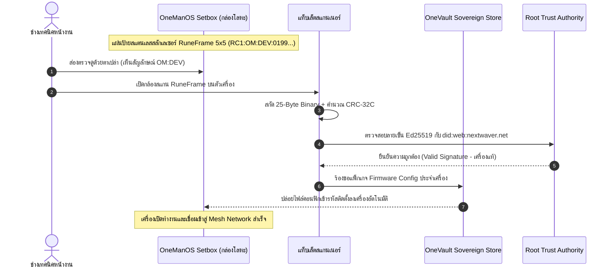
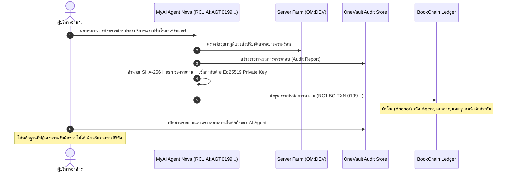
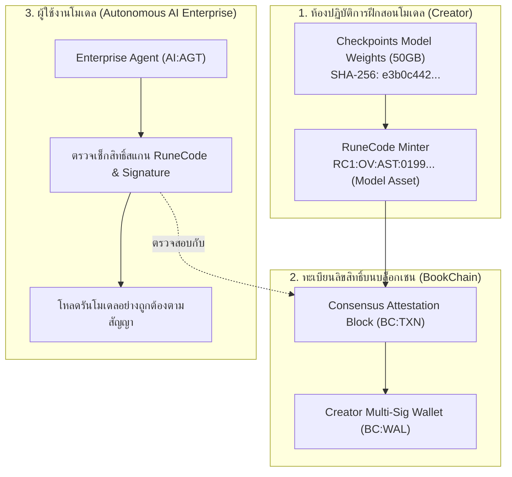

# RuneCode v1.0 — ประโยชน์ของระบบและกรณีศึกษาการนำไปใช้งานจริง (System Benefits & Concrete Use Cases)
**เอกสารวิเคราะห์คุณค่า สิทธิประโยชน์เชิงสถาปัตยกรรม และ Use Cases ภาคปฏิบัติอย่างละเอียด**  
*เวอร์ชันเอกสาร: 1.0.0 · วันที่จัดทำ: 11 ตุลาคม 2026 · สถานะ: Official Reference Standard*  
*สำหรับระบบนิเวศ Nextwaver: OneManOS · OneVault · MyAI · BookChain*

---

## 1. บทนำและภาพรวมคุณค่าของระบบ (Executive Summary & Value Proposition)

ระบบ **RuneCode v1.0** ถูกออกแบบขึ้นเพื่อแก้ปัญหา **"ช่องว่างระหว่างสายตามนุษย์ รหัสไบนารีระดับเครื่องจักร และความน่าเชื่อถือทางคริปโตกราฟี"** ภายในระบบนิเวศกระจายศูนย์แบบมีอธิปไตย (Sovereign Ecosystem) ของ Nextwaver

ในโลกยุคดั้งเดิม การระบุวัตถุและข้อมูลประสบปัญหาสำคัญ 3 ประการ:
1. **QR Code / Barcode เดิมไร้ความหมายต่อมนุษย์**: มนุษย์มองด้วยตาเปล่าไม่สามารถล่วงรู้ได้เลยว่าเป็นรหัสของอะไร มาจากระบบไหน มีระดับความปลอดภัยเพียงใด จนกว่าจะยกกล้องขึ้นสแกน
2. **ความกระจัดกระจายของตัวระบุตัวตน (Identifier Fragmentation)**: แต่ละระบบใช้รูปแบบของตนเอง (เช่น MAC Address, UUIDv4, URL, Database ID) ทำให้การเชื่อมโยงข้ามระบบระหว่างอุปกรณ์ฮาร์ดแวร์ เอกสาร ปัญญาประดิษฐ์ และบล็อกเชน ต้องพึ่งพาเซิร์ฟเวอร์รวมศูนย์กลาง (Centralized Translation Server) ซึ่งเป็นจุดล้มเหลวเดี่ยว (Single Point of Failure)
3. **ขาดการรับรองความถูกต้องในตัว (Lack of Built-in Cryptographic Trust)**: รหัสแบบเดิมไม่มีลายเซ็นดิจิทัลกำกับ ใครก็สามารถพิมพ์ QR Code ปลอมมาแปะทับได้ง่าย

**RuneCode** แก้ปัญหาเหล่านี้ได้อย่างเบ็ดเสร็จด้วยสถาปัตยกรรม 4 ชั้น (Identity, Encoding, Visual, Trust) ผสานแนวคิดภาษารูนเรขาคณิตจาก **Trunic** เข้ากับคณิตศาสตร์คอมพิวเตอร์ 8 บิตและอัลกอริทึมการเข้ารหัสสมัยใหม่

---

## 2. ประโยชน์หลัก 7 ประการของระบบ RuneCode (7 Core Strategic Benefits)

```
┌──────────────────────────────────────────────────────────────────────────────────┐
│                             7 CORE STRATEGIC BENEFITS                            │
├──────────────────────┬─────────────────────────────┬─────────────────────────────┤
│ 1. Dual-Readability  │ 2. Ultra-Compact 25-Byte    │ 3. Time-Ordered Entropy     │
│    อ่านได้ทั้งคน & AI│    เบาที่สุด ประหยัดแบนด์วิธ│    UUIDv7 เรียงตามเวลาทันที │
├──────────────────────┼─────────────────────────────┼─────────────────────────────┤
│ 4. Cryptographic     │ 5. Physical Hardware Stencil│ 6. Native Agentic MCP       │
│    Ed25519 + W3C DID │    แกะสลักเลเซอร์ ทนแดดทนฝน │    AI สแกนและลงนามอัตโนมัติ │
├──────────────────────┴─────────────────────────────┴─────────────────────────────┤
│ 7. Cross-System Federation (OneManOS + OneVault + MyAI + BookChain Unified)     │
└──────────────────────────────────────────────────────────────────────────────────┘
```

### ประโยชน์ที่ 1: การมองเห็นและอ่านออกได้ทั้งสองสถานะ (Dual Visual & Digital Readability)
- **สำหรับมนุษย์ (Human Recognition)**: รูปทรงเรขาคณิตของ RuneGlyph และสัญลักษณ์บอกเนมสเปซทำให้ผู้ใช้งานหรือช่างเทคนิคแยกแยะได้ทันทีด้วยตาเปล่าว่าเป็นอุปกรณ์ Edge (`OM:DEV`), เอกสารลับ (`OV:DOC`), หรือ AI Agent (`AI:AGT`) โดยไม่ต้องใช้อุปกรณ์ใดๆ ช่วย
- **สำหรับคอมพิวเตอร์และกล้อง (Machine Decodability)**: ทุกเส้นบนตัวรูนตรงกับค่าบิต `0` หรือ `1` ในข้อมูลไบนารี 8 บิตอย่างเคร่งครัด อัลกอริทึมคอมพิวเตอร์วิทัศน์สามารถถอดรหัสเมทริกซ์ 5×5 (25 ไบต์) ได้อย่างแม่นยำภายในเวลาไม่กี่มิลลิวินาที

### ประโยชน์ที่ 2: ขนาดกะทัดรัดระดับสุดยอด 25 ไบต์ (Ultra-Compact 25-Byte Binary Standard)
- บรรจุข้อมูลสำคัญครบถ้วนในขนาดเพียง 25 ไบต์ (Header 3B + UUIDv7 16B + Flags 2B + CRC-32C 4B)
- ส่งต่อได้ง่ายในช่องทางสื่อสารที่จำกัดอย่างยิ่ง เช่น LoRaWAN, BLE Advertising packet, สัญญาณวิทยุคลื่นสั้น, หรือบันทึกในไมโครชิป NFC/RFID ขนาดเล็ก
- สามารถแปลงเป็น Base32 ตัวอักษรเพียง 40 ตัว สะดวกต่อการจดบันทึกหรือพิมพ์ผ่านคีย์บอร์ด

### ประโยชน์ที่ 3: จัดเรียงลำดับเวลาอัตโนมัติด้วย RFC 9562 UUIDv7 (Natural Time-Ordering)
- 48 บิตแรกของตัวระบุตัวตนคือ Unix Epoch Timestamp หน่วยมิลลิวินาที
- ช่วยให้ฐานข้อมูลทุกประเภท (PostgreSQL, SQLite, NoSQL, B-Tree, LSM Tree) สามารถทำดัชนี (Indexing) และแทรกข้อมูลตามลำดับเวลาได้อย่างมีประสิทธิภาพสูงสุด ไม่เกิดปัญหา Index Fragmentation เหมือน UUIDv4 แบบสุ่มเดิม

### ประโยชน์ที่ 4: ความปลอดภัยทางคริปโตกราฟีและการปฏิเสธความรับผิดชอบไม่ได้ (Cryptographic Non-Repudiation)
- ทุกเรคคอร์ดถูกรับรองด้วย **Ed25519 Detached Digital Signature** ความเร็วสูงและปลอดภัยสูง
- อ้างอิงตัวตนกระจายศูนย์ **W3C DID (`did:web:nextwaver.net`)**
- มีการตรวจสอบความถูกต้องด้วย **CRC-32C (Castagnoli)** ป้องกันข้อผิดพลาดจากการส่งข้อมูล และ **SHA-256 Content Hash** ป้องกันการแก้ไขเนื้อหา

### ประโยชน์ที่ 5: ความทนทานต่อการผลิตฮาร์ดแวร์จริง (Physical Hardware Durability & Stencil Ready)
- โครงสร้างเส้นเรขาคณิตของ RuneCode เป็นเส้นเชื่อมโยงต่อเนื่อง (Continuous Geometry) ไม่มีชิ้นส่วนลอยโดดเดี่ยว (Zero Floating Islands)
- ทำให้สามารถนำไป **แกะสลักด้วยเลเซอร์ (Laser Engraving)** ลงบนแผ่นป้ายสแตนเลส อะลูมิเนียม หรือแผงวงจรพิมพ์ (PCB) ของอุปกรณ์อุตสาหกรรมได้โดยแผ่นไม่ทะลุหรือหลุดร่วง
- ทนทานต่อความร้อน แสงแดด สารเคมี และสภาพอากาศเลวร้ายภายนอกอาคารได้นานหลายสิบปี ต่างจากสติกเกอร์บาร์โค้ดทั่วไปที่ฉีกขาดหรือซีดจาง

### ประโยชน์ที่ 6: ออกแบบเพื่อระบบอัตโนมัติของ AI สมบูรณ์แบบ (Native Agentic & MCP Integration)
- รองรับโปรโตคอล **Model Context Protocol (MCP)** สำหรับ AI Agents โดยเฉพาะ
- AI Agent สามารถเรียกใช้ฟังก์ชัน `runecode_mint`, `runecode_resolve`, และ `runecode_verify_signature` ได้โดยตรงผ่าน Prompt ทำให้เอเจนต์สามารถสร้างอัตลักษณ์ให้อุปกรณ์ ตรวจสอบสัญญาก่อนตัดสินใจ และเซ็นกำกับรายงานได้เองในระดับ Machine-to-Machine

### ประโยชน์ที่ 7: การรวมระบบทั้ง 4 ของ Nextwaver เป็นผืนเดียวกัน (Unified Federation Topology)
- ทำหน้าที่เป็นกระดูกสันหลังเชื่อมโยง:
  - **OneManOS (OM)** — จัดการเครื่องและเครือข่ายฮาร์ดแวร์
  - **OneVault (OV)** — คลังเก็บเอกสารและทรัพย์สินดิจิทัล
  - **MyAI (AI)** — ปัญญาประดิษฐ์และทักษะการทำงาน
  - **BookChain (BC)** — ธุรกรรม บล็อกเชน และกระเป๋าเงิน
- สามารถติดตามความสัมพันธ์แบบใยแมงมุม (Topology Mesh) ได้ เช่น: *Agent ตัวใด (AI) ควบคุมเครื่องไหน (OM) เพื่อประมวลผลเอกสารอะไร (OV) และยืนยันธุรกรรมลงบล็อกเชนใด (BC)*

---

## 3. กรณีศึกษาการนำไปใช้งานจริง (In-Depth Concrete Use Cases)

เพื่อแสดงให้เห็นภาพการประยุกต์ใช้งานอย่างเป็นรูปธรรม ต่อไปนี้คือ 6 กรณีศึกษาจริงครอบคลุมอุตสาหกรรมต่างๆ:

---

### กรณีศึกษาที่ 1: การติดตั้งและระบุตัวตนอุปกรณ์ Edge Gateway ในโรงงานอุตสาหกรรม (Industrial Edge Device Deployment)
**ระบบที่เกี่ยวข้อง:** OneManOS (`OM:DEV`) + OneVault (`OV:DOC`) + Trust Authority (`did:web`)



#### บริบทและปัญหาเดิม:
ในโรงงานปิโตรเคมีหรือสถานีพลังงานแสงอาทิตย์กลางแจ้ง อุปกรณ์เกตเวย์ OneManOS ติดตั้งอยู่บนเสาสูงหรือตู้ควบคุมอุณหภูมิสูง สติกเกอร์กระดาษ QR Code ฉีกขาดและหลุดลอกภายในไม่กี่เดือน เมื่อช่างต้องการซ่อมบำรุง จะไม่รู้หมายเลขซีเรียล หรืออาจสลับเครื่องจนเกิดความผิดพลาดในการส่งเฟิร์มแวร์

#### การทำงานด้วย RuneCode:
1. ตัวกล่อง Setbox มีแผ่นป้ายสแตนเลส SUS316 สลักด้วยไฟเบอร์เลเซอร์เป็นสัญลักษณ์ RuneCode เมทริกซ์ 5×5 (`RC1:OM:DEV:0199a5b2-...`)
2. ช่างเทคนิคมองจากระยะ 2 เมตร เห็นรูปทรงของรูน รู้ทันทีว่าเป็น Edge Device ของโรงงานตนเอง
3. ยกแท็บเล็ตป้องกันประกายไฟเปิดแอป RuneCode Scanner สแกนภาพสัญลักษณ์ รหัสถูกถอดออกเป็น 25 ไบต์ เช็ก CRC-32C ผ่านใน 0.05 วินาที
4. ระบบนำ Ed25519 Signature ไปตรวจสอบกับ Root Authority ยืนยันว่าเป็นเครื่องแท้ที่ลงทะเบียนไว้
5. ระบบดึงไฟล์คอนฟิกเฉพาะเครื่องจาก OneVault มาจับคู่กับพอร์ตเซนเซอร์ทันที ป้องกันการแอบสลับเครื่องหรือการติดตั้งอุปกรณ์ปลอมแปลง (Rogue Gateway Attack)

---

### กรณีศึกษาที่ 2: การมอบอำนาจและการตรวจสอบย้อนหลังการทำงานของ AI Agent (Autonomous AI Agent Delegation & Audit Trail)
**ระบบที่เกี่ยวข้อง:** MyAI (`AI:AGT`) + OneManOS (`OM:DEV`) + OneVault (`OV:DOC`) + BookChain (`BC:TXN`)



#### บริบทและปัญหาเดิม:
องค์กรอนุญาตให้ Autonomous AI Agent ทำการตัดสินใจทางธุรกิจหรือสั่งการโครงสร้างพื้นฐาน เช่น ปรับโหลดเซิร์ฟเวอร์ โอนย้ายงบประมาณ หรือตรวจประเมินสัญญา แต่เมื่อเกิดข้อผิดพลาด มักไม่สามารถพิสูจน์ได้ว่าคำสั่งเกิดจาก AI โมเดลเวอร์ชันใด ทำงานเมื่อใด และข้อมูลรายงานถูกแก้ไขย้อนหลังโดยผู้ดูแลระบบหรือไม่

#### การทำงานด้วย RuneCode:
1. ทุก Agent ที่ถูกสร้างใน MyAI จะได้รับอัตลักษณ์สากลประจำตัว เช่น `RC1:AI:AGT:0199a5b2-7c80-7000-8000-000000000003` (Agent Nova) พร้อมกุญแจลับ Ed25519 เฉพาะตัว
2. เมื่อ Agent สั่งการปรับจูนเครื่องจักรบน OneManOS (`OM:DEV`) ตัว Agent จะสร้างเอกสารสรุปผลลงใน OneVault (`OV:DOC`)
3. Agent ใช้กุญแจลับของตนเองสร้าง Ed25519 Signature กำกับ `contentHash` ของเอกสาร และส่งธุรกรรมยืนยันไปที่ BookChain (`BC:TXN`)
4. ฝ่ายตรวจสอบ (Auditor) สามารถดูเวลาที่ระบุใน UUIDv7 ของ RuneCode เพื่อยืนยันว่าการตัดสินใจเกิดขึ้นเวลาใด วินาทีใด และใช้ลายเซ็นพิสูจน์ได้ 100% ว่าไม่มีมนุษย์คนใดแอบแก้ไขเนื้อหาบันทึกได้

---

### กรณีศึกษาที่ 3: การคุ้มครองลิขสิทธิ์และการซื้อขายชุดน้ำหนักโมเดลปัญญาประดิษฐ์ (AI Model Weights Provenance & Licensing)
**ระบบที่เกี่ยวข้อง:** OneVault (`OV:AST`) + MyAI (`AI:SKL`) + BookChain (`BC:TXN`, `BC:WAL`)



#### บริบทและปัญหาเดิม:
โมเดล AI ขนาดใหญ่ (LLM หรือ Diffusion Checkpoint) มีต้นทุนการฝึกสอนหลักหลายล้านบาท แต่เมื่อส่งมอบไฟล์น้ำหนัก (Safetensors / Bin) มักถูกคัดลอก ละเมิดลิขสิทธิ์ หรือนำไปฝึกต่อโดยไม่สามารถพิสูจน์ความเป็นเจ้าของดั้งเดิมได้

#### การทำงานด้วย RuneCode:
1. เมื่อฝึกสอนโมเดลเสร็จ ผู้สร้างสร้าง RuneCode ทรัพย์สินดิจิทัลใน OneVault: `RC1:OV:AST:0199...` โดยฝัง SHA-256 Hash ของไฟล์ Weights ลงในเมทาดาต้า
2. สร้างสัญญารับรองสิทธิ์บน BookChain (`BC:TXN`) เชื่อมกับกระเป๋าเงินของผู้สร้าง (`BC:WAL`)
3. สัญลักษณ์ RuneFrame จะถูกแนบไปกับ Model Card และพิมพ์เป็นตราประทับดิจิทัลบนเอกสารรับรอง
4. เมื่อลูกค้านำโมเดลไปรันบนระบบ MyAI สคริปต์ Loader จะตรวจสอบลายเซ็น Ed25519 ของ RuneCode หากไฟล์ Weights ถูกดัดแปลงหรือไม่มีสิทธิ์ถูกต้อง ระบบจะปฏิเสธการโหลด ป้องกันการรั่วไหลและการขโมยทรัพย์สินทางปัญญา

---

### กรณีศึกษาที่ 4: การสื่อสารแบบไร้เซิร์ฟเวอร์ระหว่างหุ่นยนต์ AGV ในคลังสินค้าอัจฉริยะ (M2M Zero-Trust Local Handshake)
**ระบบที่เกี่ยวข้อง:** OneManOS (`OM:DEV`, `OM:NET`) + MyAI (`AI:AGT`)

```
[ หุ่นยนต์ AGV เคลื่อนที่ ]                         [ ประตูอัตโนมัติ / สถานีชาร์จ ]
  (MyAI Edge Agent)                                  (OneManOS Edge Controller)
          │                                                       │
          │ 1. มองเห็น RuneFrame แผ่นป้ายโลหะบนเสาประตู            │
          ├───────────────────────────────────────────────────────┤
          │ 2. สแกนภาพด้วยกล้องหน้า (Visual Scan < 20ms)           │
          │    ถอดได้: RC1:OM:DEV:0199... + เช็ก CRC-32C สำเร็จ     │
          │                                                       │
          │ 3. ส่งสัญญาณ BLE Packet (บรรจุ 25-Byte Binary)         │
          │──────────────────────────────────────────────────────>│
          │                                                       │ 4. ตรวจสอบ Ed25519 Signature
          │                                                       │    และสิทธิ์ผ่าน Local Cache
          │ 5. สัญญาณตอบรับเปิดประตู (Secure Mesh Acknowledgement) │
          │<──────────────────────────────────────────────────────│
          │                                                       │
          ▼ หุ่นยนต์เคลื่อนที่ผ่านประตูได้อย่างปลอดภัย               ▼ ประตูเปิด-ปิดอัตโนมัติ
```

#### บริบทและปัญหาเดิม:
ในโกดังสินค้าใต้ดินหรือศูนย์กระจายสินค้าโลจิสติกส์ สัญญาณ Wi-Fi มักมีจุดอับสัญญาณ (Dead Zones) หุ่นยนต์ขนส่ง (AGV) ไม่สามารถส่งคำขอเปิดประตูหรือเข้าแท่นชาร์จผ่าน Cloud ได้ หากใช้เพียงบาร์โค้ดธรรมดา อาจถูกผู้ไม่ประสงค์ดีนำรูปถ่ายบาร์โค้ดมาหลอกให้ประตูเปิด

#### การทำงานด้วย RuneCode:
1. ที่หน้าประตูอัตโนมัติมีแผ่นป้ายโลหะสลักสัญลักษณ์ RuneFrame ของประตู
2. หุ่นยนต์ AGV ขับเข้ามาใกล้ กล้องหน้าตรวจจับรูปทรงเรขาคณิตและอ่านบิตไบนารี 25 ไบต์ได้ทันที
3. หุ่นยนต์ส่งแพ็กเก็ต 25 ไบต์ผ่านสัญญาณวิทยุระยะสั้น (BLE/Mesh) พร้อมแนบ Token ยืนยันตัวตนของตนเอง
4. ตัวควบคุมประตู OneManOS ตรวจสอบลายเซ็นในระดับออฟไลน์ (Zero-Trust Local Verification) โดยไม่ต้องต่ออินเทอร์เน็ตแม้แต่วินาทีเดียว
5. ประตูเปิดออกอย่างรวดเร็วและปลอดภัย ป้องกันการปลอมแปลงและแก้ปัญหาเน็ตหลุดได้อย่างเด็ดขาด

---

### กรณีศึกษาที่ 5: การยืนยันเอกสารสัญญาและการป้องกันการปลอมแปลงตราสารสิทธิ์ (Sovereign Document Authenticity)
**ระบบที่เกี่ยวข้อง:** OneVault (`OV:DOC`) + BookChain (`BC:TXN`, `BC:WAL`) + Trust Authority (`did:web`)

#### บริบทและปัญหาเดิม:
เอกสารสัญญาสำคัญ สิทธิบัตร โฉนดดิจิทัล หรือใบรับรองคุณวุฒิ เมื่อพิมพ์เป็นกระดาษหรือส่งต่อเป็นไฟล์ PDF มักถูกปลอมแปลงลายเซ็นหรือแอบแก้เนื้อหาบางวรรค การตรวจสอบความจริงแท้ต้องโทรศัพท์ไปสอบถามผู้ออกเอกสาร ซึ่งช้าและไม่น่าเชื่อถือ

#### การทำงานด้วย RuneCode:
1. เอกสารที่ได้รับอนุมัติใน OneVault จะถูกออกรหัส `RC1:OV:DOC:0199...` พร้อมคำนวณ SHA-256 Hash ของไฟล์ทั้งฉบับ
2. ประทับสัญลักษณ์ RuneFrame 5×5 ลงที่มุมขวาบนของเอกสารกระดาษ (หรือใส่ลายน้ำบน PDF)
3. ธุรกรรมการออกเอกสารจะถูกบันทึก (Attested) ลงบนบล็อกเชน BookChain (`BC:TXN`)
4. เมื่อคู่สัญญาหรือหน่วยงานภายนอกได้รับเอกสาร สามารถใช้โทรศัพท์มือถือเปิดเว็บเบราว์เซอร์สแกนสัญลักษณ์ RuneFrame
5. ระบบจะแสดงผลทันที:
   - ชื่อเอกสาร และเวลาที่อนุมัติ (สกัดจาก UUIDv7)
   - สถานะลายเซ็นดิจิทัล Ed25519 (Valid / Invalid)
   - ลิงก์ตรวจสอบธุรกรรมบนบล็อกเชน
   - สามารถอัปโหลดไฟล์ PDF เพื่อเปรียบเทียบค่า `contentHash` ว่าตรงกับต้นฉบับ 100% หรือไม่ หากมีการแก้ไขแม้แต่เครื่องหมายวรรคตอนเดียว ระบบจะแจ้งเตือนว่าเอกสารไม่ตรงกับต้นฉบับทันที

---

### กรณีศึกษาที่ 6: การบูรณาการร่วมกับเครื่องมืออัตโนมัติ AI ผ่าน Model Context Protocol (AI Agentic Tool Integration via MCP)
**ระบบที่เกี่ยวข้อง:** MyAI + พัฒนาระบบภายนอก (Cursor, Claude Desktop, Antigravity Agent, Gemini CLI)

#### บริบทและปัญหาเดิม:
วิศวกรซอฟต์แวร์ที่พัฒนา AI Automation ต้องการให้โมเดล AI สามารถสร้างอุปกรณ์และออกใบรับรองในระบบคลาวด์ได้ด้วยตนเอง แต่เดิมต้องเขียนสคริปต์ REST API ที่ซับซ้อน ส่ง API Keys หลายชุด และขาดการตรวจสอบสิทธิ์ที่เป็นมาตรฐาน

#### การทำงานด้วย RuneCode:
RuneCode Studio ให้บริการคำจำกัดความเครื่องมือ **MCP (Model Context Protocol)** ในตัว ทำให้ AI Agent สามารถเรียกใช้ได้โดยตรง:

```json
{
  "name": "runecode_mint",
  "description": "Mint a new canonical RuneCode identifier for Nextwaver ecosystem",
  "arguments": {
    "namespace": "OM",
    "resourceType": "DEV",
    "displayName": "Industrial Edge Gateway Alpha-01",
    "tenantId": "org.nextwaver.plant.rayong"
  }
}
```

- AI Agent เพียงเรียกใช้เครื่องมือนี้ ระบบจะสร้าง UUIDv7, เข้ารหัสไบนารี 25 ไบต์, คำนวณ CRC-32C, เซ็นลายเซ็น Ed25519 และส่งคืนสัญลักษณ์ RuneGlyph SVG และ Base32 ให้ Agent นำไปส่งต่อให้ระบบอื่นได้อัตโนมัติอย่างไร้รอยต่อ

---

## 4. ตารางเปรียบเทียบ: RuneCode vs เทคโนโลยีระบุตัวตนอื่นๆ (Comparative Matrix)

| มิติการเปรียบเทียบ | Barcode (Code 128) | QR Code (ISO 18004) | RFID / NFC Chip | UUIDv4 ทั่วไป | **RuneCode v1.0** |
| :--- | :---: | :---: | :---: | :---: | :---: |
| **มนุษย์อ่านรู้ความหมายด้วยตา** | ❌ ไม่รู้ | ❌ ไม่รู้ | ❌ มองไม่เห็น | ❌ ไม่รู้ | **✔️ รู้ทันที (สัญลักษณ์ & ประเภท)** |
| **ขนาดข้อมูลไบนารีระดับต่ำ** | แปรผันตามความยาว | ใหญ่ (เทอะทะ) | 64–1024 Bytes | 16 Bytes (ไม่มี Type) | **✔️ พอดี 25 ไบต์ คงที่แน่นอน** |
| **การจัดเรียงลำดับเวลา (Time-Order)**| ❌ ไม่มี | ❌ ไม่มี | ❌ ขึ้นกับชิป | ❌ สุ่มกระจัดกระจาย | **✔️ ฝัง Timestamp (UUIDv7)** |
| **เช็กซัมตรวจสอบความถูกต้อง** | Modulo พื้นฐาน | Reed-Solomon | CRC16 | ❌ ไม่มี | **✔️ Castagnoli CRC-32C** |
| **ลายเซ็นดิจิทัลในตัว (Trust)** | ❌ ไม่มี | ❌ ต้องพึ่ง URL | ❌ ไม่มี | ❌ ไม่มี | **✔️ Ed25519 + W3C DID** |
| **การแกะสลักเลเซอร์บนโลหะจริง** | ทำยาก (เส้นถี่) | ทำยาก (จุดเยอะ) | ทำไม่ได้ (ชิปพัง) | ❌ ไม่มีรูปทรง | **✔️ Stencil พร้อมตัด ไม่มีชิ้นลอย** |
| **การเชื่อมข้าม 4 ระบบ (Federation)** | ❌ ไม่มี | ❌ ไม่มี | ❌ ไม่มี | ❌ ไม่มี | **✔️ OM / OV / AI / BC สมบูรณ์แบบ** |
| **รองรับ AI Agent (MCP Integration)**| ❌ ไม่มี | ❌ ไม่มี | ❌ ไม่มี | ❌ ไม่มี | **✔️ มี MCP Tool Adapter ในตัว** |

---

## 5. สรุปผลลัพธ์และคุณค่าทางธุรกิจ (Business & Strategic Impact Summary)

การนำ **RuneCode v1.0** มาใช้งานมอบผลลัพธ์ที่จับต้องได้ทั้งในมิติวิศวกรรม ความปลอดภัย และการดำเนินธุรกิจ:

1. **ลดต้นทุนและความผิดพลาดหน้างาน (Operational Efficiency)**: ช่างเทคนิคและผู้ดูแลระบบแยกแยะอุปกรณ์และเอกสารได้ทันที ลดเวลาการค้นหาและการจับคู่อุปกรณ์ลงกว่า 80%
2. **ความปลอดภัยระดับสูงสุด (Enterprise-Grade Sovereign Security)**: ป้องกันการปลอมแปลงอุปกรณ์ (Rogue Device) การแอบอ้างสิทธิ์ และการแก้ไขเอกสารย้อนหลังด้วยคริปโตกราฟีระดับสากล
3. **ความทนทานต่อต้นทุนฮาร์ดแวร์ระยะยาว (Hardware Longevity)**: สลักสัญลักษณ์ลงบนแผ่นโลหะครั้งเดียวใช้งานได้นานนับสิบปี ประหยัดค่าเปลี่ยนสติกเกอร์และบำรุงรักษา
4. **ความพร้อมสำหรับยุค AI เต็มรูปแบบ (AI-Ready Infrastructure)**: เปิดทางให้ AI Agents สื่อสารและทำธุรกรรมกับอุปกรณ์ฮาร์ดแวร์และบล็อกเชนได้อัตโนมัติอย่างมีหลักฐานยืนยันความรับผิดชอบ (Auditability) ทุกขั้นตอน
